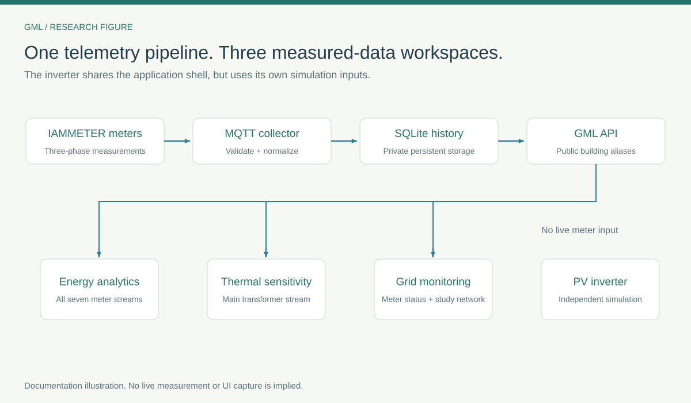
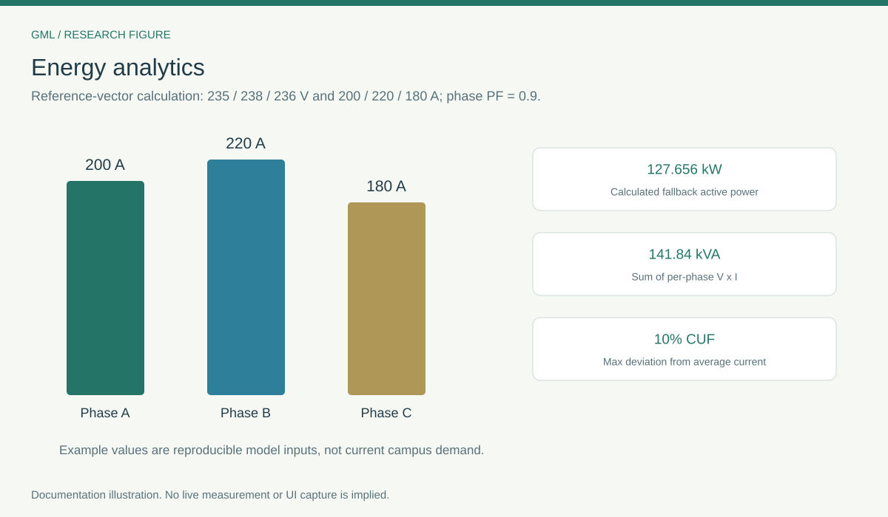
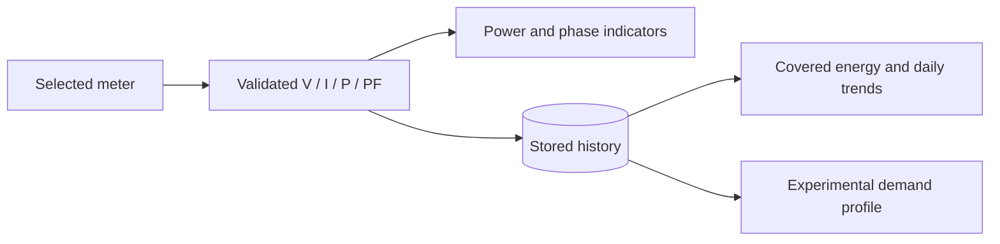
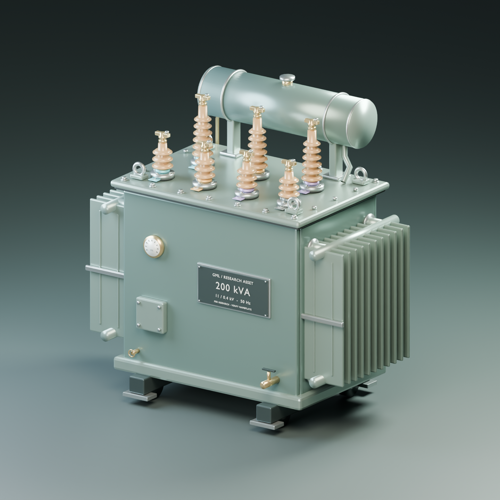
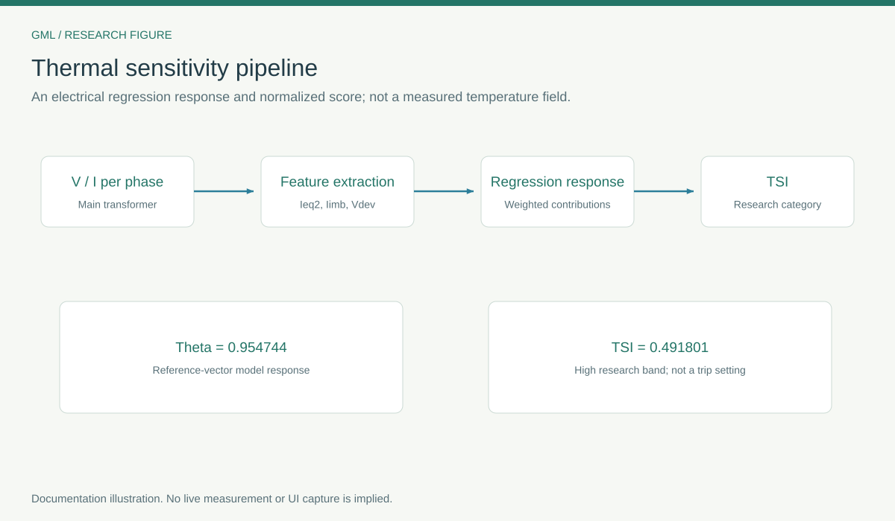
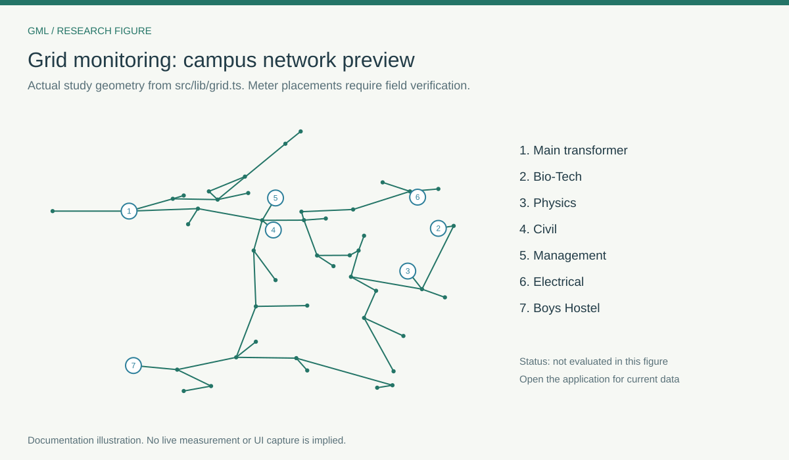
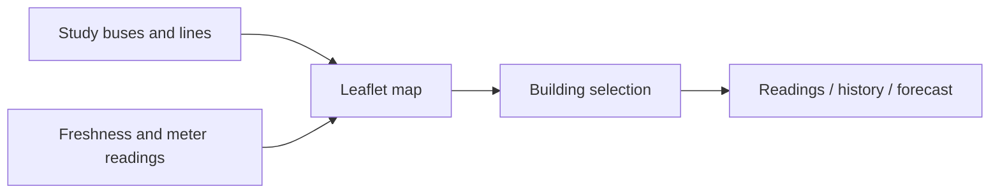
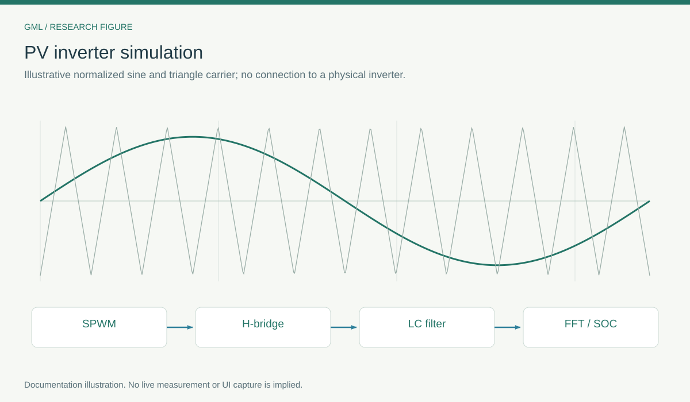
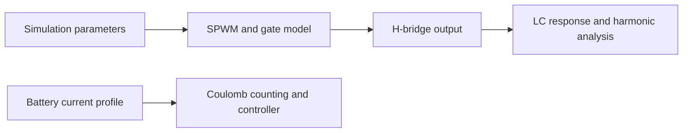

# iGrid - GRID Modernization Laboratory research OPEN SOURCE

<p align="center"></p>

**Kathmandu University · Four research workspaces · One application**

[Get started](#run-the-system) · [Software details](softwaredetails.md) · [cPanel deployment](CPANEL.md) · [Technical report](docs/PROJECT_REPORT.md) · [Figures](docs/assets/README.md)

A research console for building energy analytics, transformer thermal sensitivity, campus grid monitoring and PV inverter simulation. The intended deployment address is **https://gmlab.ku.edu.np/research/**. This repository is prepared for [DVA-Code/iGrid](https://github.com/DVA-Code/iGrid); publishing the source does not deploy the Python backend or collector.

> **Status:** the local implementation has been built and tested. KU hosting still needs an application slot and approved continuous MQTT collection. Three workspaces use meter telemetry; the inverter uses simulation parameters. Missing readings are never proof of a physical fault.



## Explore the four projects

### 1. Building energy analytics



Select a building to examine phase voltage/current, active power, apparent power, power factor, phase deviation indicators and stored energy history. Daily and seasonal views show the data coverage alongside calculated totals. Experimental forecasts are produced only when the required fresh history is available.

**How it works:** MQTT readings enter the backend, pass validation and are stored in SQLite. The selected building's normalized readings feed the energy equations; longer date ranges come from the history/analytics API. Energy simulation is removed from this workspace. The figure above is a labelled calculation example, not live consumption.



**Start reading the code:** [EnergyPage.tsx](src/pages/energy/EnergyPage.tsx), [StoredAnalytics.tsx](src/pages/energy/StoredAnalytics.tsx), [energy.ts](src/lib/models/energy.ts).

### 2. Transformer thermal sensitivity



*Existing model render used by the project; not a thermographic measurement.*

The main-transformer meter supplies three-phase voltage and current. The workspace shows the regression features, each formula's contribution, a normalized thermal-sensitivity index and an interactive 3D explanation. Explicit simulation controls support study scenarios.



The thermal output is a **research response level**, not degrees Celsius. The animation is not a calibrated physical temperature field or a protection system. Coefficients, applicability and the transformer nameplate need field validation.

**Start reading the code:** [ThermalPage.tsx](src/pages/thermal/ThermalPage.tsx), [thermal.ts](src/lib/models/thermal.ts), [RealisticTransformer.tsx](src/components/three/RealisticTransformer.tsx).

### 3. Grid monitoring and building map



*Preview generated from the actual study coordinates and line connections in the project. It is not a browser screenshot or a live-status snapshot. All meter-to-bus placements still require field confirmation.*

The application overlays meter status on the campus study network. Users can pan/zoom, select a building, inspect its readings below the map, and move into historical/forecast analysis. Map arrows illustrate connections and data context. They do not prove conductor continuity, breaker position or a fault location.



**Start reading the code:** [MapPage.tsx](src/pages/map/MapPage.tsx), [GridMap.tsx](src/pages/map/GridMap.tsx), [grid.ts](src/lib/grid.ts).

### 4. PV inverter simulation



Explore sine/triangle comparison, unipolar SPWM, H-bridge states, dead-time assumptions, LC filtering, FFT/THD and battery state of charge. The workspace distinguishes simulated/calculated results from values transcribed from the supplied prototype report.



**This project does not consume live IAMMETER readings.** It shares navigation, theme and visualization components with the other projects. There is no live inverter-control connection.

**Start reading the code:** [InverterPage.tsx](src/pages/inverter/InverterPage.tsx), [DesignLab.tsx](src/pages/inverter/DesignLab.tsx), [inverter.ts](src/lib/models/inverter.ts).

## Run the system

### Install these tools first

| Tool | Purpose |
|---|---|
| Node.js 22.13+ / supported Node 24 LTS | Frontend build and local Node MQTT/SQLite service |
| npm, included with Node | Installs the exact JavaScript dependency trees from lockfiles |
| Python 3.11+ recommended | Python hosting backend, setup helpers, packaging and Python tests; verify the runtime on the host |
| Git, optional for local run | Cloning, version control and publishing changes |

JavaScript requirements are in [package.json](package.json), [server/package.json](server/package.json) and both lockfiles. Python requirements are in [requirements.txt](requirements.txt). Python libraries alone do not install the React/Node system.

### From the developer ZIP

1. Extract `GML_Developer_Complete.zip` into a folder you control. Open its **iGrid** folder in VS Code.
2. Open the integrated terminal in that folder, where `package.json` is visible. Run:

```powershell
node --version
npm.cmd --version
npm.cmd run setup
```

The setup installs frontend and Node-backend dependencies and creates missing local configuration from examples. Existing credentials and registry files are preserved. It does **not** install Node or Python on the computer.

3. Edit `server/.env` privately. Enter dedicated MQTT username/password; never your normal IAMMETER account login. The authorized developer ZIP includes the meter registry; the public GitHub ZIP uses placeholders. Replace placeholders in `server/meters.json` when using public source. Keep public building IDs unchanged.
4. Start:

```powershell
npm.cmd run dev
```

Open the printed URL, normally **http://localhost:5173**. The UI can be opened without MQTT credentials, but measured workspaces will accurately show unavailable data. Inverter simulation and explicit thermal simulation remain available. Do not interpret an open dashboard as evidence of a live feed.

Stop from another terminal in the same project folder:

```powershell
npm.cmd stop
```

On Linux/macOS, use `npm` instead of `npm.cmd`. To install Python dependencies locally:

```powershell
python -m venv .venv
.\.venv\Scripts\python.exe -m pip install -r requirements.txt
```

### From GitHub

After the source is uploaded to the target repository:

```powershell
git clone https://github.com/DVA-Code/iGrid.git
cd iGrid
npm.cmd run setup
```

Configure the local files as above, then start with `npm.cmd run dev`. These instructions do not claim the repository has already been updated.

## Technology at a glance

| Layer | Implementation |
|---|---|
| Browser | TypeScript, React, CSS, Vite, Zustand |
| Charts / map / 3D | ECharts, Leaflet, Three.js, React Three Fiber |
| Local backend | JavaScript on Node.js, MQTT.js, built-in SQLite, HTTP and optional WebSocket |
| Hosted backend | Python WSGI application, separate Paho MQTT collector |
| Persistence | SQLite: readings, events, collector snapshot and predictions |
| Deployment | Compiled frontend + Python Passenger mount + supervised collector |

See **[softwaredetails.md](softwaredetails.md)** for APIs, refresh intervals, the database schema, data validation, component connections and the full file guide.

## Build, test and edit

```powershell
npm.cmd run test:launcher
npm.cmd run test:server
npm.cmd test -- --maxWorkers=1
.\.venv\Scripts\python.exe -m unittest python_backend.test_backend -v
npm.cmd run build
npm.cmd run preview
```

`src/` contains editable frontend code. `public/` contains model/logo assets. `dist/` is generated; change source and rebuild instead of editing it. See [the file map](softwaredetails.md#file-and-folder-guide).

## Host at /research

Follow **[CPANEL.md](CPANEL.md)**. The frontend belongs in `gml-console/dist`, the Python backend in `gml-console/python_backend`, and database/secrets in a separate `gml-private` folder. Passenger exposes `/research/`; the private folder is never placed in `public_html`. The account's zero-application limit and persistent-process policy must be resolved by KU.


## Documentation and credit

[Software details](softwaredetails.md)  [Technical report](docs/PROJECT_REPORT.md) ·

**Grid Modernization Laboratory, Kathmandu University**

System designed and built by **Saujan Prakash Niroula, Research Assistant Intern**. Supervisor: **Dr. Samundra Gurung**.

The repository retains its existing [MIT licence](LICENSE), copyright 2026 DVA-Code. Third-party dependencies and supplied research, logo and portrait assets retain their respective rights and notices.
