# GML research console
## Technical project report
Grid Modernization Laboratory, Kathmandu University
Implementation report | 12 November 2026 | Current development release

> **PURPOSE**
> Bring measured electrical telemetry, research calculations and visual explanation into one research workspace.


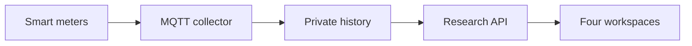


The platform consists of Energy Analytics, Transformer Thermal Sensitivity, PV Inverter Simulation and Grid Monitoring. It combines live data where available with clearly separated research models and simulations. It is intended for research observation and explanation, not autonomous protection or switching control.

Primary institution: Grid Modernization Laboratory, Kathmandu University. System design and development: Saujan Prakash Niroula, Research Assistant Intern. Supervisor: Dr. Samundra Gurung.

This report describes the code currently implemented. Numerical examples are reproducible model/test cases unless explicitly labelled as measured observations. It does not claim that the proposed KU deployment is complete, that all seven meters are publishing, or that the simulations have been validated as physical equipment models.

> **RESULT AT A GLANCE**
> Local software implementation and a production build are complete for review. Fifty-five automated tests passed in the recorded verification. Five meter feeds were observed; two had no messages during that observation. Hosting and field validation remain open.


Reading route: system architecture; ingestion workflow; database; four project models; forecasting; evidence; security and deployment; research limitations and next steps.

---

# 1. System architecture
> **INPUT / OUTPUT**
> Input: three-phase MQTT messages and user-selected simulation parameters. Output: validated history, status, calculated indicators, maps and animations.

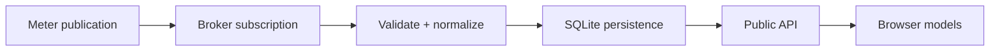


The frontend is React and TypeScript, built with Vite. ECharts supports charts, Leaflet provides the map, and Three.js/React Three Fiber support the transformer visualization. Public assets include the lab logo, portraits and transformer model/fallback.

The local service is Node.js with MQTT.js, a SQLite store and read-only HTTP endpoints. It also exposes a WebSocket interface. The production alternative is Python WSGI for the API/frontend, with a separate Paho collector. The hosted frontend uses same-origin HTTP reads; meter acquisition remains MQTT rather than IAMMETER cloud-API polling.

Two processes have separate duties: the collector continually writes validated readings and heartbeat state; web workers answer browser requests. Starting a collector inside each Passenger worker would duplicate subscribers and writers, so the deployment uses one independent supervised collector.

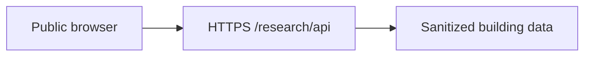


The public interface receives stable building aliases. Physical serial numbers, MQTT credentials and the database remain behind the server boundary. Public telemetry itself is intentionally inspectable. Hardware replacement can be reflected in the private registry while preserving the public building ID.

Source anchors: src/components/Shell.tsx; server/index.js; server/public-wire.js; python_backend/app.py; python_backend/collector.py; passenger_wsgi.py.

Deployment decision: the existing KU cPanel screenshot has a zero-application quota. The platform is prepared for deployment, but enabling Python alone does not provide continuous MQTT collection. A persistent collector and private storage must also be approved.

---

# 2. Acquisition and status workflow
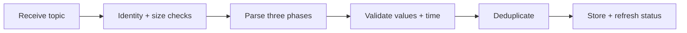


The Node parser expects three phase arrays. Each phase supplies voltage, current, active power, imported energy, exported energy, frequency and power factor. Legacy strict decimal strings are converted to numbers; malformed values are rejected. The payload identity must match the subscribed topic. The parser rejects oversized payloads, retained messages and invalid/future device timestamps.

If no device timestamp exists, reception time is recorded and the reading is marked RECEPTION_TIME_ONLY. This preserves the distinction between an instrument timestamp and server receipt. Per-phase power is summed to kW; imported/exported counters are summed separately. Zero power factor is a valid value, not automatically replaced by a default.


Status is evidence-based. NOT_CONFIGURED indicates missing server settings. CONNECTING waits for connection/subscriptions. Authentication/subscription errors describe a rejected broker operation. NO DATA means no valid reading exists. STALE means a stored reading is too old. COLLECTOR_OFFLINE in Python means the stored collector heartbeat expired.

The default meter freshness threshold is 120 seconds and may expand based on observed intervals. Python considers the collector heartbeat active for less than 15 seconds; the collector writes state periodically. A network reset does not prove a power outage. A LIVE broker does not automatically imply seven LIVE meters.

Reconnection must subscribe to all seven topics again and wait for acknowledgements. Tests exercise reconnect recovery and stale acknowledgements that must not incorrectly restore LIVE. Rejected messages and connection changes are recorded as events.

Implementation limits: Node and Python diagnostics do not always offer the same granularity. Python may report a general network connection failure where the local Node service can distinguish DNS, reset or permission errors. Neither can identify a physical wire fault from absent telemetry.

---

# 3. Data model and history
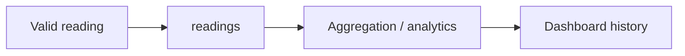


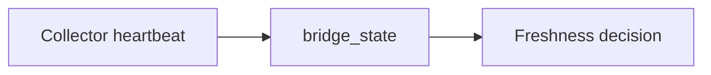

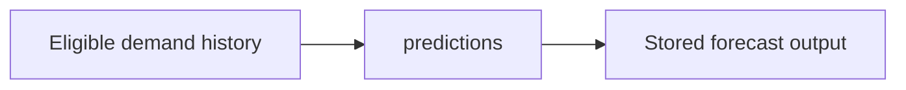


SQLite stores four core tables. readings uses a composite (sn, t) primary key with received time and normalized JSON. events stores a timestamp, meter identity, event kind and detail. bridge_state stores the collector snapshot/heartbeat. predictions stores meter, generation time and forecast JSON. Hardware identifiers remain internal; serializers expose building aliases.

WAL mode supports the intended single-writer/readers pattern. It is not a substitute for proper filesystem locking or unlimited storage. The production file is /home/gmlabatku/gml-private/gml.sqlite; local development uses server/data/gml.sqlite. Neither belongs under public_html or in GitHub.

History queries use bounded ranges and aggregation. Python validates routes and query parameters and sets a query execution budget. Coverage describes stored observations and dates, not a guarantee of uninterrupted collection. Aggregation can reduce chart payload size but does not fill missing measurements.

Energy histories integrate net active power over covered intervals and exclude long gaps. Counter decreases are recorded; they are not converted into fabricated positive consumption. Nepal-day boundaries use UTC+05:45. Display time is Nepal time, while timestamps are epoch milliseconds.

> **WHY THIS MATTERS**
> A smooth chart can be misleading if data gaps are silently interpolated. Coverage, stale status and measured-versus-derived labels should be interpreted alongside totals.


SQLite backups must use a consistent backup operation or a correctly stopped database transfer. Replacing source code must preserve the private database. A production retention policy and off-host restore test are still required because account disk space is finite.

Source anchors: server/store.js; python_backend/app.py; python_backend/config.py; python_backend/runtime.py.

---

# 4. Energy analytics: model and flow
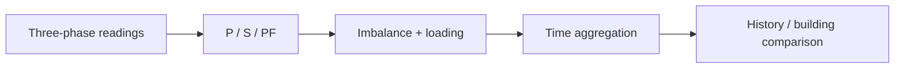


The active-power function prefers meter-reported pKw. If unavailable, the calculation is:

```text
P = (Va Ia PFa + Vb Ib PFb + Vc Ic PFc) / 1000   [kW]
S = (Va Ia + Vb Ib + Vc Ic) / 1000               [kVA]
PF = P / S                                     [dimensionless]
Loading = 100 S / rated_kVA                     [%]
```

The energy-study voltage/current unbalance indicators use maximum deviation from the phase average:

```text
Xavg = (Xa + Xb + Xc) / 3
Deviation factor = 100 max(|Xa-Xavg|,|Xb-Xavg|,|Xc-Xavg|) / Xavg
E = sum( (P[k-1] + P[k]) / 2 * delta_hours )    [kWh]
```

VUF and CUF here are scalar max-deviation indicators, not negative-sequence components. A near-zero average returns an unavailable result. This definition differs from the thermal project's max-minus-min current imbalance. Derived reactive power is an approximation; it is not a direct measurement of signed reactive power or a full harmonic power decomposition.

The implemented research rating is 200 kVA and needs nameplate confirmation. The helper's historical comparison uses an assumed PF of 0.8; this is not a substitute for live measured PF. Gaps longer than the chosen coverage threshold are excluded from energy integration. The frontend helper and backend histories have their own configured gap policies; use the API's reported method and coverage for stored totals.

> **REPRODUCIBLE EXAMPLE**
> Va/Vb/Vc = 235/238/236 V; Ia/Ib/Ic = 200/220/180 A. S = 141.84 kVA and loading = 70.92% at 200 kVA. With all phase PF = 0.9, fallback P = 127.656 kW. CUF = 10%; VUF is approximately 0.7052%.


Interpretation: phase B carries the highest current. These are reference-vector calculations, not a live measurement of current campus demand. Source: src/lib/models/energy.ts and models.test.ts.

---

# 5. Transformer thermal sensitivity
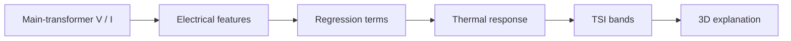


The model exposes its contributions rather than hiding a score. With currents in amperes and voltages in volts:

```text
Ieq2 = (Ia^2 + Ib^2 + Ic^2) / 3
Iimb = 100 (Imax - Imin) / Iavg
Vdev = Vavg - 240.0981
Theta = -0.97180955 + 0.00004761 Ieq2
        + 0.00083054 Iimb + 0.00190004 Vdev
TSIraw = (Theta - (-0.86)) / (2.83 - (-0.86))
```

Theta is a model-derived thermal-response level, not degrees Celsius. TSI is normalized relative to the implementation's reference interval. The raw value is retained outside [0,1]; display clamping must not erase out-of-range evidence. Bands are low, moderate, high, very high and critical in steps of 0.2. Those labels describe research categories, not certified trip settings.

> **REFERENCE RESULT**
> For the same 235/238/236 V and 200/220/180 A vector: Ieq2 = 40266.6667 A^2; Iimb = 20%; Vdev = -3.7647667 V; Theta is approximately 0.954744; raw TSI is approximately 0.491801, in the high research band.


Why: the squared-current term dominates this example (about 1.917096). Imbalance contributes about 0.016611, voltage deviation about -0.007153, and the intercept is -0.971810. The animated model helps show contributions and electrical flow; it does not constitute a physical temperature-field solution, a calibrated cooling model or a transformer failure predictor.

Zero-current behavior and invalid values are handled explicitly in the model tests. Field use requires verification of coefficients, applicability to the actual transformer, data range and calibration against independent temperature measurements. No new regression training or field accuracy assessment was performed in this documentation task.

Source: src/lib/models/thermal.ts, models.test.ts and transformer visualization components. The source comment attributes the coefficients to the supplied thermal study; that attribution is recorded here without asserting publication status or independent replication.

---

# 6. PV inverter: simulated operation
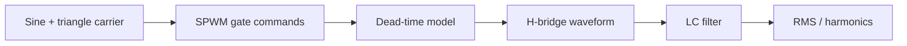

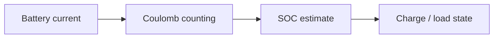


The inverter workspace has no live inverter MQTT connection. It offers a switching model and separately identified values transcribed into INVERTER_REPORTED from the supplied report.

Unipolar modulation compares a sine and its negative against the same triangular carrier. The modeled bridge produces +Vdc, 0 or -Vdc. A rising-edge delay approximates dead time; freewheeling uses a previous-state assumption. This does not replace a transistor/diode transient simulation or demonstrate real hardware gate safety.

```text
reference(t) = m sin(2 pi f_ref t)
carrier preset = 16,000,000 / (2 * 255) = 31,372.549 Hz
LC cutoff = 1 / (2 pi sqrt(L C))
THD = 100 sqrt(sum(Vn^2, n>=2)) / V1
SOC_next = clamp(SOC + I delta_t / (capacity_Ah * 3600), 0, 1)
```

The LC filter is evaluated in the frequency domain with load resistance and assumed inductor ESR (default 0.5 ohm). This gives damping and a steady-state response; it is not a measured filter trace. Coulomb counting uses positive charging current and demonstrates drift from sensor offset. The controller table uses 50% and 90% thresholds, while transcribed prototype code constants differ; they must not be presented as identical implementations.

> **CALCULATED / REPORTED**
> L = 250 microhenry and C = 1 microfarad give cutoff about 10,065.84 Hz. Harmonic-table recomputation gives filter THD about 5.32% and transformer THD about 34.31%. The transcribed report gives 5.31% and 34.66%, respectively; differences remain visible.


Reported prototype values also include about 145 V no-load and 15.83 V with a 1000-ohm load, below a 220 V target. These are supplied-report values, not newly measured dashboard results. Reported 12 kHz switching differs from the timer-derived 31.37 kHz; an observed 20 microsecond dead time differs from the simple 2.5 microsecond constant/clock calculation. These discrepancies require hardware investigation, not silent correction.

---

# 7. Grid monitoring and visualization
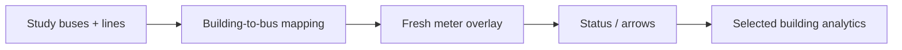


The map imports bus/line geometry and study loading values into src/lib/grid.ts, attributed there to the existing laboratory load-flow map. Leaflet supports base-map switching, pan/zoom, building selection and lines. Resize handling updates map dimensions after layout changes and avoids overriding deliberate user pan/zoom.

Seven public building aliases are mapped to study buses. All seven placement records currently carry verified: false. The topology and placement need confirmation against actual campus drawings and field records. A plausible-looking connection arrow is not proof that a particular conductor is energized.

> **DATA LAYERS**
> Measured: meter voltage/current/power and receipt status. Calculated: indicators derived from those readings. Study: stored topology and historical loading values. Illustrative: animated direction/flow. Unknown: breaker state, conductor continuity and physical fault location.


The inference helper checks freshness before interpreting readings. Fresh voltages below 40 V on all phases receive a low-voltage warning; one or two such phases receive a low-phase-voltage warning. These thresholds are application research checks, not confirmation of outage origin. Apparent power above a configured rating is a comparison against that rating, not a thermal protection verdict.

No recent messages must remain stale/no-data, with physical cause unverified. A broker error, browser/API failure and missing meter publication are different layers. The dashboard's explanation should reflect the layer supported by evidence.

Building readings below the map connect location selection with electrical analytics and history. The map does not implement state estimation, a solved real-time load flow, protective relay telemetry or remote switching. Those would require additional equipment data, verified topology and control authorization.

Source anchors: src/lib/grid.ts; src/pages/map/GridMap.tsx; map/model tests. A code enum may use an internal name such as outage while the displayed explanation deliberately states low voltage rather than a confirmed equipment failure.

---

# 8. Forecasting and seasonal interpretation
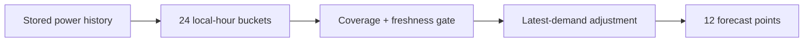


The backend uses local-hour-profile-v1: an experimental hourly baseline, not a trained neural network or independently validated AI service. It reads up to seven days of history, excludes the most recent hour from the profile, and groups past power by Nepal hour of day.

A forecast is withheld unless there is at least 24 hours of span, observations in every local hour, and a recent latest reading (within six minutes in the backend gate). When eligible:

```text
mu[h] = mean historical power for Nepal hour h
ratio = clamp(latest_power / mu[current_hour], 0.5, 2)
forecast[k] = mu[hour(now + k*15 minutes)] * ratio
k = 1..12  => next three hours
```

If the current hourly baseline is not positive, the backend uses a ratio of 1. Valid forecasts are saved in the prediction table; Python generation is bucketed at ten-minute resolution. Stored predictions can support later comparison but do not themselves prove accuracy.

The frontend grid helper also contains a profile forecast implementation with different scaling details. Therefore, report which implementation produced a result; do not assume frontend and backend helper outputs are numerically identical. A future consolidation should establish one versioned prediction contract.

Season labels are approximate study calendar windows: October festival, November-February winter and the remaining months summer. They are not weather measurements or proof of causal seasonal effects. Meaningful seasonal comparisons require sufficient real observations in each window and consideration of occupancy, holidays, missingness and meter changes.

> **EVALUATION STILL REQUIRED**
> Use chronological holdout data. Compare MAE/RMSE against persistence and unscaled hour-of-day baselines; report coverage and error by building/time. No measured forecast accuracy, savings percentage or annual seasonal result is claimed here.


Source: server/prediction.js; python_backend/app.py forecast; src/lib/grid.ts. The existing explanation layer is rule-based and model-based; calling it explainable AI must not imply learned fault diagnosis.

---

# 9. Results and what they establish
> **MEASURED OBSERVATION**
> Earlier local collection on 12 November 2026 received fresh messages from Main Transformer, Bio-Tech, Physics, Management and Electrical. Civil and Boys Hostel supplied no messages in that observation. This is a time-bounded observation, not their guaranteed current state.


The observation demonstrates an end-to-end path for five feeds: MQTT reception, validation, storage and API delivery. It does not validate the missing meters, prove campus-wide availability or locate physical faults. Exact measured kW totals are not reproduced because no preserved measurement table was selected for this report.

> **AUTOMATED EVIDENCE**
> Recorded verification: 4 launcher tests + 12 Node backend tests + 4 Python backend tests + 35 frontend/model tests = 55 passing tests. Production TypeScript/build passed. Both npm audits reported zero known vulnerabilities at the time checked.


Tests cover reference equations, boundaries, no-load behavior, energy integration and gap handling, inverter waveforms/calculations, MQTT reconnect acknowledgement handling, malformed/retained messages, history persistence, public identifier sanitization and local access restrictions. They establish defined software behavior for those cases, not physical model validity across all operating conditions.

The stop command was exercised against the local running launcher and stopped its owned dashboard/backend while preserving history. Duplicate startup reused existing services. Access attempts to private development files returned denied responses. Production theme asset delivery was checked against the WSGI path.

What remains unverified: actual KU Passenger deployment, Linux supervisor operation on KU infrastructure, reboot recovery there, physical phone/tablet rendering, measured transformer-temperature agreement, inverter hardware operation, forecast holdout accuracy, topology placement and a full penetration test.

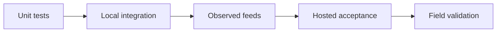


The first three stages have recorded evidence with the limits above. Hosted acceptance and field validation remain distinct work packages. Avoid presenting a complete-looking UI as evidence that the latter stages are finished.

---

# 10. Security and operational design
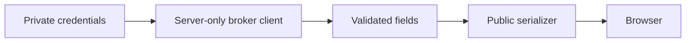


The local bridge binds to loopback and checks Host/Origin. Its stop-control endpoint uses a random token and workspace identity; it rejects browser-origin requests. Development static-file restrictions protect backend/private paths. The Python production application requires HTTPS, serves only built public assets, bounds queries and returns generic errors instead of secret-bearing raw exceptions.

The private configuration is created outside both application and public web folders with restrictive permissions. Python collector locking prevents a second instance owning the same database. Production process supervision, restart-on-failure, backups and logging still depend on hosting configuration.

Public data is deliberately available to all visitors. No frontend mechanism can prevent a visitor from inspecting readings already delivered to their browser. The security goal is to keep credentials, runtime controls, raw private registries and database files off the public surface.

Residual concerns include plaintext MQTT on the current documented broker port, the broker's development/testing positioning, finite disk quota, public endpoint traffic load, third-party map tile availability and the need to review supplied research assets before public GitHub release. A zero-advisory dependency audit does not certify the entire application.

GitHub preparation uses a placeholder meter registry and excludes local credentials/history. The deployment package retains a private registry for the authorized server and is not the public repository upload. If a secret has ever been committed, ignoring the file later is insufficient; revoke/rotate the secret and review repository history.

> **OPERATIONS ACCEPTANCE**
> Confirm HTTPS, correct /research mount, one supervised collector, fresh per-meter data, growing coverage, private-file denial, backup restoration and continued collection after closing the setup terminal. The practical deployment runbook supplies the steps.


Do not deploy the Vite development server as the public hosting solution. Keep the existing GML website separate and mount the production Python application at the requested path.

---

# 11. Limitations and research roadmap

Priority 1 - deployment: obtain KU application capacity and approved supervision, install the Python service, validate /research, test recovery and establish private backups. If unavailable, use an approved complete external host with a redirect or administrator-managed reverse proxy.

Priority 2 - instrumentation: investigate the two unobserved feeds with the meter administrator; confirm device upload settings without assuming faults. Verify all bus placements and the transformer rating. Capture independent breaker/relay/temperature telemetry if physical fault interpretation is required.

Priority 3 - model validation: compare thermal response with independent temperature measurements and assess applicability of coefficients. Reconcile inverter timer, switching and dead-time discrepancies with oscilloscope evidence. Keep reported prototype values distinct from simulations and new measurements.

Priority 4 - analytics: collect sustained coverage, evaluate forecasts chronologically and compare naive baselines. Define calendar/occupancy effects and data-quality exclusions before seasonal conclusions. Unify duplicated forecast implementations and document backend differences.

Priority 5 - platform quality: perform real browser/device acceptance, hosted load testing, dependency maintenance and a scoped security assessment. Define data retention, incident response and ownership for ongoing operation.

> **CONCLUSION**
> The project provides an implemented research integration platform with transparent models and verified local behavior. It does not yet establish a deployed operational control system, calibrated digital twin, field-proven fault detector or accurate seasonal predictor.


Implementation references: src/lib/models/thermal.ts; energy.ts; inverter.ts; models.test.ts; src/lib/grid.ts; server/index.js; parse.js; store.js; prediction.js; public-wire.js; python_backend/app.py and collector.py; deploy/; SECURITY_REVIEW.md.

External operational references:
https://www.iammeter.com/blog/subscribe-real-time-energy-data-mqtt
https://docs.cpanel.net/cpanel/software/application-manager/
https://docs.cpanel.net/knowledge-base/web-services/how-to-install-a-python-wsgi-application/

The supplied research documents are reflected in implementation comments and report constants. Their bibliographic/publication status and experimental claims should be checked against the original documents before submitting an academic paper. This report is a software implementation and verification report, not an independently replicated experimental paper.
