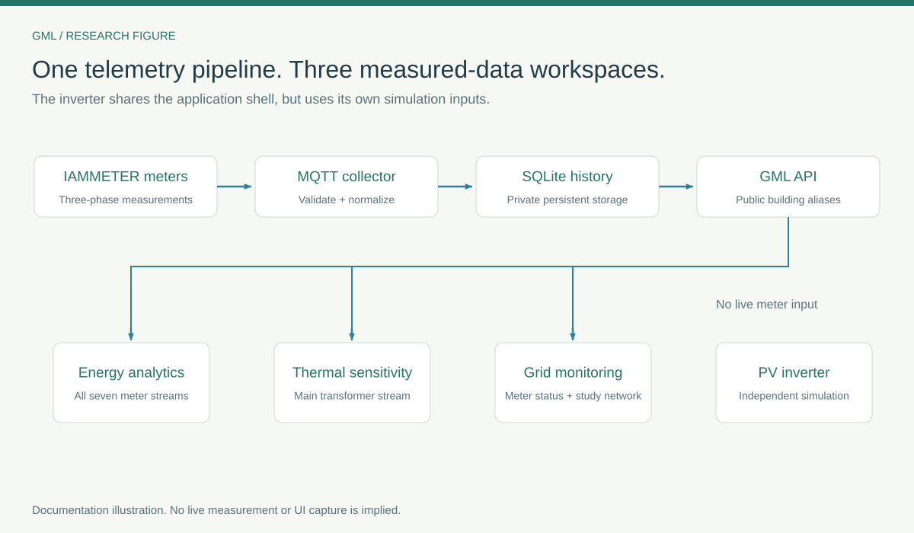
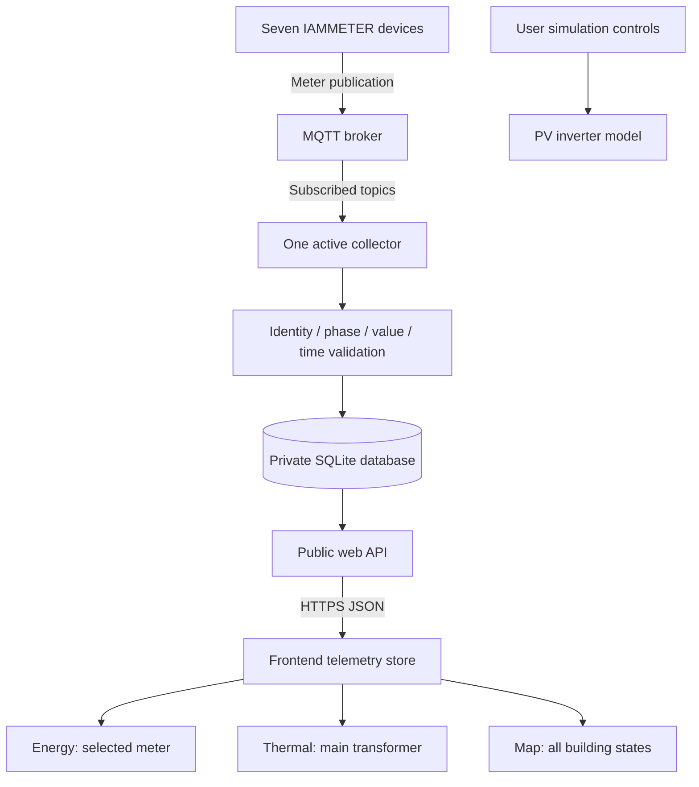
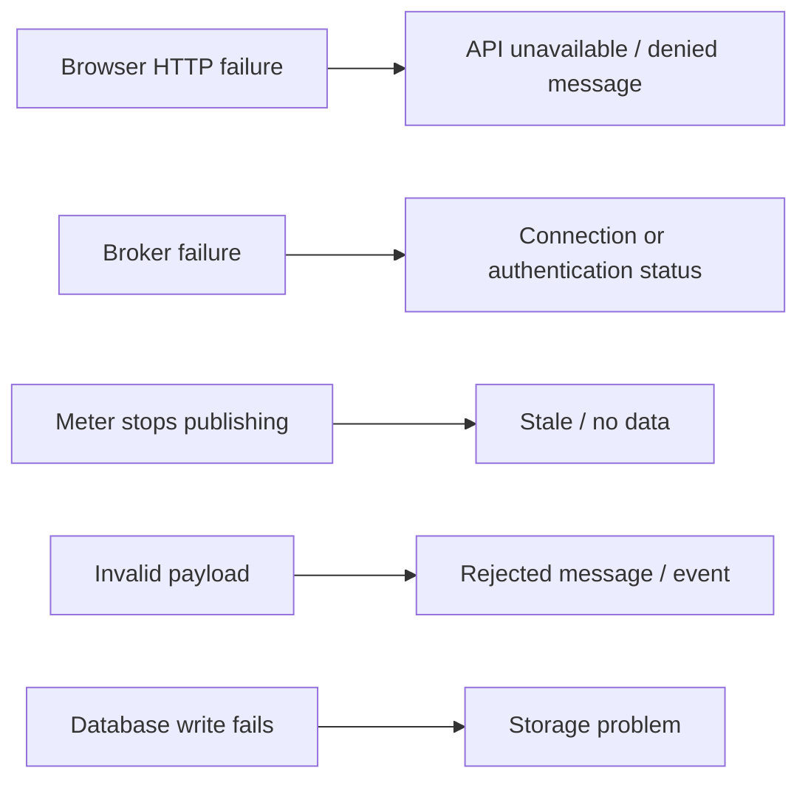

# Software details - iGrid research console

This guide explains the implemented code, not a proposed future architecture. It accompanies [README.md](README.md) and [CPANEL.md](CPANEL.md).

## Languages and runtime roles

| Layer | Language / runtime | Main libraries | Responsibility |
|---|---|---|---|
| Browser | TypeScript/TSX + CSS | React, Zustand, ECharts, Leaflet, Three.js, React Three Fiber, KaTeX, Framer Motion | Navigation, selected building, charts, formulas, map and models |
| Build | Node.js | TypeScript, Vite, Tailwind/PostCSS | Check source types and compile browser assets into dist |
| Local API/collector | JavaScript, Node.js | MQTT.js, dotenv, ws, node:sqlite | Subscribe to MQTT, validate, persist and expose data locally |
| Hosted API | Python, WSGI | Standard library sqlite3, JSON, HTTP/WSGI helpers | Serve dist and sanitized data under /research |
| Hosted collector | Python | Paho MQTT plus shared backend modules | Continuous broker subscription and database writes |
| Storage | SQLite | WAL journal and indexed tables | History, events, collector state and forecast records |

Node is needed on the developer's computer. The Python cPanel deployment serves a prebuilt frontend and does not require a Vite process or npm on the host. Python requirements do not install JavaScript dependencies: use both the appropriate requirements file and npm lockfiles.

## End-to-end connections

The local Node service combines the collector and API in one process. Production separates Python web workers from one persistent collector. Multiple web workers must not each create an MQTT connection. Do not run Node and Python collectors simultaneously against the same production history.

## Which API is called?

The browser calls the **GML backend API**, not an IAMMETER cloud REST API. Direct MQTT acquisition occurs on the backend. The hosted browser normally requests JSON over HTTP at a short interval; this does not change the acquisition mechanism into cloud polling.

| Method and path | Consumer | Response purpose |
|---|---|---|
| GET /api/status | src/lib/store.ts via telemetry.ts | Broker state, reason, server timestamp and seven meter records |
| GET /api/history/{building}?range=24h | history.ts and initial store loading | Aggregated readings and stored coverage |
| GET /api/analytics/{building}?range=7d | StoredAnalytics.tsx | Daily net energy, covered hours, peak and reset information |
| GET /api/forecast/{building} | forecast.ts / ForecastPanel | Experimental profile forecast and stored-forecast count |
| GET /api/events | EventLog.tsx | Recent connection/validation/counter events |
| GET /api/coverage | Verification and tooling | First/last timestamps, sample counts and sampled days |

When mounted at /research, these become `/research/api/status`, `/research/api/history/main-transformer?range=24h`, and so on. Building IDs are `main-transformer`, `block-7`, `block-6`, `block-11`, `block-10`, `block-8`, `boys-hostel`. They are not hardware serial numbers.

History/analytics support bounded time ranges; optional `from`, `to` and `step` use milliseconds. Python restricts routes and parameters; total requested interval is limited to 366 days. Events may be filtered by `sn`, which here means the public building ID. API responses do not expose broker credentials. Browser endpoints are intended for reading; forecasting may persist a generated result on the server as part of its implementation.

Default API base is derived from Vite's BASE_URL and the current page. An optional VITE_API_BASE can override it for a deliberately configured separate API. VITE_LIVE_WS enables an optional WebSocket path on a compatible backend; Python WSGI deployment uses HTTP and does not require WebSocket proxying. Never put secrets in any VITE_ variable: those values can enter the browser bundle.

### Update timing

- `startFeed()` starts once from `App.tsx` and disposes previous subscriptions/timers before replacement.
- Status HTTP polling runs every 3 seconds when a recent WebSocket snapshot is unavailable. Requests have a 7-second timeout.
- A 1-second UI tick advances clocks and freshness checks; it does not create new measurements.
- A status stream that stops advancing for about 15 seconds cannot keep claiming a verified live connection.
- Stored history, stored analytics and forecast hooks normally refresh every 60 seconds. Initial short history is loaded for a meter once a valid reading arrives.
- The meter's actual publication interval is independent of these UI refresh intervals. A 3-second browser poll cannot turn a 60-second meter publication into a new measurement every 3 seconds.

## How the MQTT broker is used

Server settings define the broker host/port, dedicated MQTT username/password and TLS flag. The documented existing route is `mqtt.iammeter.com:1883`, without TLS. The collector resolves each authorized serial from `server/meters.json` and subscribes to `device/{SN}/realtime` for all seven meters. The public frontend registry stores only building aliases.

IAMMETER documents dedicated credentials under its MQTT settings. Do not substitute the normal IAMMETER account login. A successful TCP connection alone is not success: authentication, subscription acknowledgement and valid fresh messages are separate stages.

The Node implementation uses a random client ID, clean sessions and explicit resubscription on each connection, with checks that all topics were granted. Stale acknowledgements from a closed connection cannot restore LIVE. The Python Paho client subscribes again on connect and uses a bounded reconnect delay. No inbound broker listener is opened by this application.

Do not change already-working meter upload settings to deploy the frontend. Missing publications require the meter administrator to verify configuration and connectivity. A migration to a TLS broker is a separate meter/network task. Website HTTPS does not encrypt the documented MQTT port 1883 leg.

## Message validation and identity

`server/parse.js` and `python_backend/collector.py` implement normalization/validation. Expected three-phase arrays contain voltage, current, watts, imported energy, exported energy, frequency and PF. Strict numeric strings from legacy firmware are accepted where supported; invalid values are rejected.

Identity must match the subscribed meter. Retained messages are rejected because freshness is not independently established. Payload size, phase shape, finite values, ranges and timestamps are checked. Future device times are rejected. If the device does not provide a timestamp, reception time is used and labelled accordingly. A valid zero PF is retained.

Stored identities are private hardware serials. Public serializers convert them to stable building aliases and allowlist fields; arbitrary payload extensions or raw exceptions are not returned to the browser. Replacing a physical device can therefore preserve the public building key.

## How the four projects share the system

| Project | Uses live telemetry? | Data selection | What happens to that data |
|---|---|---|---|
| Energy | Yes | Selected one of seven meters | Computes P/S/PF, phase deviations and loading; requests history, analytics and forecast |
| Thermal | Yes, or explicit study simulation | Main transformer | Computes electrical features, regression terms and TSI; drives visualization |
| Grid map | Yes | All seven meter statuses/latest readings | Overlays data on study topology and links building selection to analytics |
| PV inverter | No | User-selected model parameters / reported constants | Simulates switching, filtering, harmonics, battery SOC and controller behavior |

`src/lib/store.ts` is the shared Zustand telemetry store. `useLive.ts` selects the current reading and applies energy and thermal calculations. `history.ts` and `forecast.ts` retrieve persisted data. The inverter shares the shell, navigation, theme, chart/formula components and simulation controls, not the MQTT measurement input. A lab-level header may still display feed state while the inverter simulation is open.

Energy has no simulation mode in its active workspace. The code retains explicit demo data for supported study scenarios; those samples are not a substitute for missing measured telemetry and are not silently written into history.

## Models in brief

- **Energy:** meter-reported active power is preferred; otherwise sum phase V x I x PF. Apparent power sums phase V x I. CUF/VUF are max-deviation indicators, not negative-sequence calculations. Covered net energy uses trapezoidal integration and excludes gaps. Study loading assumes 200 kVA and needs nameplate confirmation.
- **Thermal:** Ieq-squared, max-minus-min current imbalance and mean voltage deviation feed a fixed regression. Theta is a response level, not Celsius. TSI maps a reference interval to a display scale and preserves out-of-range raw values.
- **Grid:** study coordinates/edges plus live status. All meter-bus placements are currently unverified. Low voltage may be flagged from received values, but conductor and breaker conditions are unknown.
- **Inverter:** sine/triangle comparison, simplified dead time and bridge states, frequency-domain LC response, FFT/THD, and coulomb counting. Prototype report values are labelled separately.
- **Forecast:** an experimental hour-of-day profile based on stored demand. Backend coverage/freshness gates suppress unsupported forecasts; the current backend predicts 12 points at 15-minute spacing. It is not a trained general fault-diagnosis model.

See [PROJECT_REPORT.md](docs/PROJECT_REPORT.md) for equations, reference calculations and limitations. Some frontend helper and backend calculation variants exist; do not assume byte-for-byte parity between all helper paths.

## Database and stored state

| Table | Main fields | Purpose |
|---|---|---|
| readings | sn, t, received, data JSON; primary key (sn,t) | Validated telemetry, deduplication and historical calculations |
| events | id, sn, t, kind, detail | Communication transitions, rejections and counter/voltage events |
| bridge_state | key, data JSON | Collector heartbeat and latest connection snapshot |
| predictions | sn, t, data JSON; primary key (sn,t) | Forecast records generated when eligible |

Local default: `server/data/gml.sqlite`. Python production: `GML_DB` in private config, normally `/home/gmlabatku/gml-private/gml.sqlite`. The schema is created at runtime. SQLite is a server file, not a MySQL account: no cPanel Database Wizard or remote database access is required.

SQLite WAL and private storage permissions must work on the host filesystem. The collector is a single writer by design. Persistent history is not the same as browser memory: Zustand holds recent data for rendering; SQLite survives restarts. Local storage currently keeps theme preference, not credentials or the full research database.

No automatic research-history deletion is configured. Establish quota monitoring and a backup/retention policy. Use SQLite's consistent backup API; copying a live .sqlite file without considering WAL can lose data. Never put database files into a public GitHub repository or web directory.

## File and folder guide

| Path | Contains | Why it is here / edit guidance |
|---|---|---|
| README.md | Project overview, figures and start commands | Repository entry point |
| softwaredetails.md | This implementation guide | Developer orientation |
| CPANEL.md | Complete hosting procedure | KU operator/developer handover |
| requirements.txt | Includes backend Python dependencies | Standard root pip entry point |
| package.json / package-lock.json | Frontend, build and script dependencies | npm ci reproduces the JavaScript dependency tree |
| server/package.json / package-lock.json | Local Node backend dependencies | Installed separately by setup |
| index.html / src/main.tsx / App.tsx | Browser bootstrap and hash routes | App root; do not replace the external GML homepage |
| src/lib/store.ts / telemetry.ts | Shared readings and API transport | Connection validation, freshness and source state |
| src/lib/useLive.ts / history.ts / forecast.ts | Model selection and data hooks | Shared consumption without repeated broker connections |
| src/lib/models/ | Energy, thermal, inverter equations and tests | Scientific calculations, distinct from rendering |
| src/lib/data/demo.ts | Explicit study/demo sample generator | Required source module; must be packaged, never confused with server history |
| src/lib/grid.ts | Study buses/lines and placement helpers | Mapping assumptions and network geometry |
| src/pages/energy/ | Energy pages and stored analytics | Building power and history interface |
| src/pages/thermal/ | Thermal pages | Electrical-to-thermal model explanation |
| src/pages/map/ | Leaflet map and building panel | Spatial interface |
| src/pages/inverter/ | Inverter workspace/design tools | Simulation interface |
| src/pages/lab/ | Lab information and people | Institutional context |
| src/components/ | Shared shell, status, formulas, charts and 3D | Reusable UI; legacy filenames may still mention OSI although displayed content uses TCP/IP |
| src/index.css / workspace.css / theme-dark.css | Styling and responsive rules | Edit source CSS, not generated dist CSS |
| public/ | Logo, team portraits, GLB and model render | Static assets copied into dist by build |
| docs/assets/ | Labelled documentation figures | README images; not live screenshots |
| server/index.js / parse.js | Local HTTP/MQTT bridge and parser | Development collection/service |
| server/store.js / prediction.js | Local SQLite operations and profile baseline | Persistence and analytics |
| server/public-wire.js / diagnostics.js | Sanitization and observed failure messages | Private/public data boundary |
| server/meters.json | Actual hardware-to-building registry | Private, ignored by Git; included only in authorized deployment packages |
| server/meters.example.json | Fictional placeholders with stable public IDs | Safe bootstrap for public source |
| server/.env.example | Blank dedicated credentials template | Shareable setup template |
| server/.env / server/data/ | Local credentials/history | Private runtime files; never publish |
| python_backend/app.py | WSGI API + dist serving | Passenger calls application here |
| python_backend/collector.py | Independent MQTT subscriber | Continuous service, not a web-worker import side effect |
| python_backend/config.py / security.py | Private configuration, HTTPS/access boundary | Shared by hosted service components |
| python_backend/runtime.py | Collector lock and process identity | Avoid duplicate writers and unsafe PID stopping |
| passenger_wsgi.py | Python entry point | Mount under Passenger at /research |
| deploy/setup.py / preflight.py | Private setup and prerequisite checks | Run on authorized hosting account |
| deploy/collector.py / supervisor.conf.example | Manual collector control / supervision template | KU chooses a supported production process manager |
| scripts/start.mjs / stop.mjs / runtime-control.mjs | Local lifecycle control | Start/reuse/stop owned project services safely |
| scripts/setup.mjs | npm install workflow and missing-template creation | First run for developer |
| scripts/package-source.py / package-github.py | Allowlisted archives and privacy checks | Separates hosting/developer material from public source |
| dist/ | Compiled browser assets | Generated by npm run build; keep under app root for WSGI |
| .runtime/ / .venv/ / node_modules/ | Tokens, Python environment and installed JS libraries | Machine/runtime artifacts, not repository source |

## How an error moves through the system

A successful page load only proves static/web delivery. A successful API response only proves the request path. A LIVE broker only proves approved subscriptions. Verify new per-meter timestamps and growing history separately. Do not infer a transformer fault from a DNS failure or a power outage from silence.

## Configuration and publishing boundaries

Runtime secrets belong in server/.env locally or gml-private/gml.env on the host. The browser uses same-origin API by default; public serial aliases are safe to expose. No browser IAMMETER login or MQTT password is required.

Source changes are made in the source folder and tested before rebuilding. On cPanel, update code without replacing the private database/config. Restart Passenger and the separate collector as required. A GitHub upload is source publication only: GitHub Pages cannot run this Python/MQTT/SQLite service.

Dependency manifests are reproducible starting points, not an absolute security guarantee. npm uses the lockfiles; the Python requirement currently permits compatible Paho 2.x releases. Record the installed Python environment for deployment reproducibility and review upgrades.
